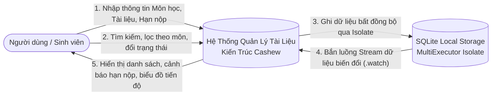
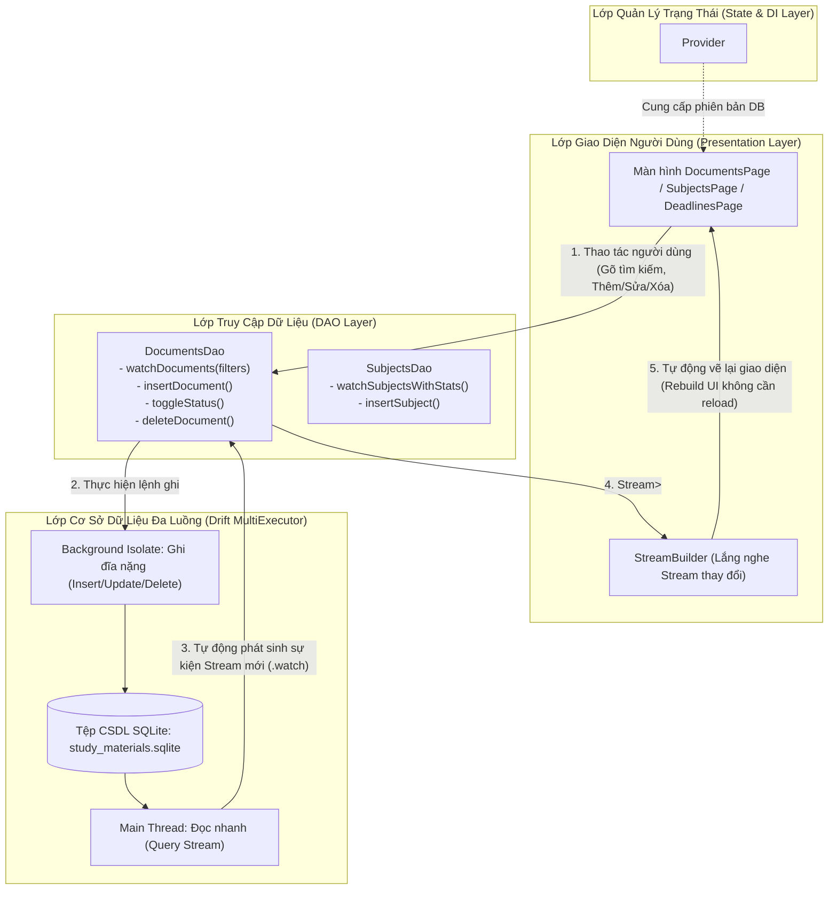
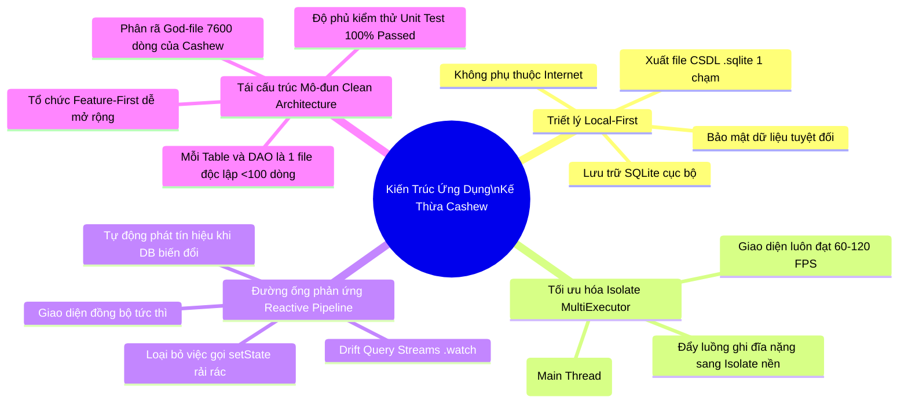

# KỊCH BẢN CHI TIẾT QUAY VIDEO DEMO
## ỨNG DỤNG QUẢN LÝ TÀI LIỆU HỌC TẬP (fromCashew2crudTaiLieuHocTap)
> **Kiến trúc:** Local-First, Drift SQLite MultiExecutor (Isolate), Reactive Pipeline, Feature-First Modularization.  
> **Thời lượng video đề xuất:** 10 – 12 phút  
> **Độ phân giải quay đề xuất:** Full HD (1920x1080) hoặc 2K, tỷ lệ 16:9  
> **Công cụ hỗ trợ:** OBS Studio / Camtasia, VS Code, Google Chrome hoặc Windows Runner, Terminal PowerShell.

---

## MỤC LỤC KỊCH BẢN VIDEO
1. [Chuẩn Bị Môi Trường Trước Khi Bấm Quay](#0-chuẩn-bị-trước-khi-quay)
2. [Phần 1 (00:00 - 02:00): Phân tích yêu cầu chức năng & Sơ đồ luồng dữ liệu (DFD)](#phần-1-phân-tích-yêu-cầu-chức-năng--sơ-đồ-luồng-dữ-liệu-dfd)
3. [Phần 2 (02:00 - 04:30): Thiết lập cấu trúc thư mục & Phân lớp hệ thống theo chuẩn Cashew](#phần-2-thiết-lập-cấu-trúc-thư-mục--phân-lớp-hệ-thống-chuẩn-cashew)
4. [Phần 3 (04:30 - 08:30): Triển khai & Demo trực tiếp các chức năng cốt lõi (CRUD & Tìm kiếm)](#phần-3-triển-khai--demo-trực-tiếp-các-chức-năng-cốt-lõi-crud--tìm-kiếm)
5. [Phần 4 (08:30 - 10:30): Kiểm thử tính đúng đắn của việc phân tách logic kiến trúc](#phần-4-kiểm-thử-tính-đúng-đắn-của-việc-phân-tách-logic-kiến-trúc)
6. [Phần 5 (10:30 - 12:00): Đóng gói mã nguồn & Báo cáo giải trình áp dụng kiến trúc Cashew](#phần-5-đóng-gói-mã-nguồn--báo-cáo-giải-trình-áp-dụng-kiến-trúc-cashew)
7. [Checklist Tổng Kết Nghiệm Thu](#checklist-tổng-kết-nghiệm-thu)

---

## 0. CHUẨN BỊ TRƯỚC KHI QUAY

### 0.1. Môi trường phần mềm
* **Visual Studio Code:** Mở sẵn thư mục `fromCashew2crudTaiLieuHocTap`. Nhấn `Ctrl + =` 1-2 lần để cỡ chữ code to, rõ ràng, dễ đọc trên video.
* **Cửa sổ ứng dụng đang chạy:**
  * Chạy trên Chrome: `flutter run -d chrome`
  * Hoặc chạy trên Windows App: `flutter run -d windows`
* **Cửa sổ Terminal thứ hai:** Đặt sẵn ở đường dẫn `c:\Users\Nguyen Tung Duong\Desktop\MobileApp\fromCashew2crudTaiLieuHocTap` để sẵn sàng gõ lệnh kiểm thử và build.
* **Tài liệu thuyết trình:** Mở file này (`HUONG_DAN_QUAY_VIDEO_DEMO.md`) hoặc slide tóm tắt sơ đồ luồng dữ liệu.

### 0.2. Dữ liệu chuẩn bị sẵn để thao tác demo
* **Môn học mới để thêm:** 
  * Mã môn: `INT3306`
  * Tên môn: `Phát triển ứng dụng Web & Di động`
  * Giảng viên: `TS. Trần Văn B`
  * Số tín chỉ: `3`
  * Màu sắc: `Xanh lá / Cam`
* **Tài liệu mới để thêm:**
  * Tiêu đề: `Đề cương ôn tập & Bài tập lớn cuối kỳ`
  * Phân loại: `Đề thi & Ôn tập`
  * Hạn nộp: `Chọn ngày bất kỳ trong tuần tới`
  * Liên kết: `https://drive.google.com/sample-docs`
  * Ghi chú: `Cần nộp trước 23h59 kèm báo cáo PDF.`
  * Đánh dấu: `Ghim lên đầu trang (Pin)`

---

## PHẦN 1. PHÂN TÍCH YÊU CẦU CHỨC NĂNG & SƠ ĐỒ LUỒNG DỮ LIỆU (DFD)
*(Thời lượng dự kiến: 00:00 – 02:00)*

### 1. Lời thoại dẫn mẫu (Voiceover Script)
> *"Kính chào thầy cô và các bạn! Hôm nay em xin trình bày video báo cáo và demo đồ án: **Xây dựng Ứng dụng Quản lý Tài liệu Học tập dựa trên nền tảng kiến trúc của ứng dụng mã nguồn mở Cashew**.*
> 
> *Là sinh viên, việc quản lý hàng chục môn học cùng hàng trăm slide bài giảng, bài tập, đề thi và hạn nộp deadline thường rất phân tán và dễ gây trễ hạn. Mục tiêu của dự án là xây dựng một giải pháp **Local-First** cực kỳ mượt mà, lưu trữ dữ liệu an toàn ngay trên thiết bị, hoạt động tức thì không cần kết nối mạng.*
> 
> *Trước tiên, em xin đi vào phần Phân tích yêu cầu chức năng và Thiết kế sơ đồ luồng dữ liệu của hệ thống."*

---

### 2. Bảng phân tích yêu cầu chức năng (Functional Requirements)

| Mã yêu cầu | Tên chức năng | Mô tả chi tiết |
| :--- | :--- | :--- |
| **FR-01** | **Quản lý Môn học (Subjects)** | Thêm, sửa, xóa môn học; lưu trữ mã môn, tên môn, giảng viên phụ trách, số tín chỉ và mã màu nhận diện; tự động tính % tiến độ hoàn thành bài tập của môn học đó. |
| **FR-02** | **Quản lý Kho tài liệu (Documents)** | Quản lý slide, bài tập, đề thi, giáo trình; hỗ trợ đính kèm tệp tin cục bộ, lưu liên kết web (Drive, Youtube); ghim tài liệu quan trọng lên đầu. |
| **FR-03** | **Theo dõi Trạng thái & Hạn nộp (Deadlines)** | Chuyển đổi trạng thái 3 bước (*Cần đọc $\rightarrow$ Đang làm $\rightarrow$ Đã hoàn thành*); tự động phân loại hạn nộp thành: *Quá hạn, Hôm nay, Tuần này, Đã hoàn thành*. |
| **FR-04** | **Tìm kiếm & Lọc đa tiêu chí** | Tìm kiếm full-text tức thì theo từ khóa trong tiêu đề/ghi chú; kết hợp lọc đồng thời theo Môn học và Loại tài liệu. |
| **FR-05** | **Sao lưu & Độc lập dữ liệu (Local-First)** | Xuất nguyên vẹn tệp cơ sở dữ liệu SQLite (`study_materials.sqlite`) để người dùng tự sao lưu hoặc chuyển đổi thiết bị mà không phụ thuộc máy chủ đám mây. |

---

### 3. Thiết kế Sơ đồ luồng dữ liệu (Data Flow Diagrams)

#### 3.1. Sơ đồ luồng dữ liệu tổng quát Cấp 0 (Context DFD)


#### 3.2. Sơ đồ luồng dữ liệu chi tiết Cấp 1 (DFD Level 1) & Kiến trúc Phản ứng (Reactive Data Pipeline)


---

## PHẦN 2. THIẾT LẬP CẤU TRÚC THƯ MỤC & PHÂN LỚP HỆ THỐNG CHUẨN CASHEW
*(Thời lượng dự kiến: 02:00 – 04:30)*

### 1. Lời thoại dẫn mẫu (Voiceover Script)
> *"Sau đây em xin mở cây thư mục mã nguồn trong VS Code để đối sánh với kiến trúc của ứng dụng Cashew gốc.*
> 
> *Trong mã nguồn nguyên bản của Cashew, tác giả James Kokoska xây dựng một ứng dụng tài chính rất mạnh mẽ, nhưng tồn tại một nhược điểm lớn: tệp `tables.dart` là một 'God-file' dài hơn 7.600 dòng gom toàn bộ schema CSDL, truy vấn và logic xử lý vào một nơi. Đồng thời các trang giao diện được đặt chung trong thư mục `lib/pages/`.*
> 
> *Để chuẩn hóa đồ án này, nhóm em đã áp dụng triệt để các nguyên lý cốt lõi của Cashew gồm **Local-First**, cơ chế đa luồng **MultiExecutor** và cơ chế phản ứng **Drift Streams**, nhưng tiến hành **Mô-đun hóa sạch sẽ (Clean Modularization)** theo mô hình **Feature-First** và tách biệt các lớp chuyên trách."*

---

### 2. Cây cấu trúc thư mục dự án (`lib/`)

```
lib/
├── database/                          # LỚP DỮ LIỆU CỐT LÕI (Core Data Layer)
│   ├── connection/                    # Quản lý kết nối CSDL đa nền tảng
│   │   ├── native.dart                # MultiExecutor: Tách Main Thread & Background Isolate
│   │   ├── web.dart                   # Hỗ trợ WebAssembly (WasmDatabase) trên Chrome
│   │   ├── shared.dart                # Điều hướng import có điều kiện (conditional export)
│   │   └── unsupported.dart
│   ├── tables/                        # Khai báo các Bảng CSDL (Entities độc lập)
│   │   ├── subjects_table.dart        # Bảng Môn học
│   │   ├── documents_table.dart       # Bảng Tài liệu học tập
│   │   ├── doc_types_table.dart       # Bảng Loại tài liệu (Slide, Bài tập, Đề thi)
│   │   ├── study_goals_table.dart     # Bảng Mục tiêu học tập
│   │   ├── delete_logs_table.dart     # Bảng Tombstone ghi nhận log xóa (Chuẩn Cashew)
│   │   └── app_settings_table.dart    # Cài đặt ứng dụng
│   ├── daos/                          # DATA ACCESS OBJECTS (Phân tách truy vấn)
│   │   ├── documents_dao.dart         # CRUD, tìm kiếm, lọc đa tiêu chí, toggle pin/status
│   │   ├── subjects_dao.dart          # CRUD môn học, tính toán % tiến độ hoàn thành
│   │   ├── doc_types_dao.dart         # Quản lý danh mục loại tài liệu
│   │   └── study_goals_dao.dart       # Quản lý mục tiêu học tập
│   ├── default_data.dart              # Khởi tạo dữ liệu mẫu lần đầu khởi chạy
│   ├── study_database.dart            # Định nghĩa @DriftDatabase tập trung các Table & DAO
│   └── study_database.g.dart          # Mã nguồn do build_runner tự động biên dịch
├── features/                          # LỚP TÍNH NĂNG THEO MIỀN (Feature-First Architecture)
│   ├── subjects/                      # Mô-đun Quản lý Môn học
│   │   ├── subjects_page.dart         # Giao diện danh sách môn & % tiến độ
│   │   └── add_edit_subject_page.dart # Form thêm/sửa môn học kèm bảng chọn màu
│   ├── documents/                     # Mô-đun Quản lý Tài liệu học tập
│   │   ├── documents_page.dart        # Kho tài liệu (Tìm kiếm full-text + Filter Chips)
│   │   ├── add_edit_document_page.dart# Form thêm/sửa tài liệu (file, link, deadline, pin)
│   │   └── document_details_page.dart # Chi tiết tài liệu, mở file/link, đổi trạng thái
│   ├── deadlines/                     # Mô-đun Theo dõi Hạn nộp
│   │   └── deadlines_page.dart        # Gom nhóm: Quá hạn, Hôm nay, Tuần này
│   └── settings/                      # Mô-đun Cài đặt & Quản trị
│       └── settings_page.dart         # Thống kê tổng quan, Xuất file database .sqlite
├── navigation/
│   └── main_navigation_framework.dart # Khung điều hướng 4 Tab dùng IndexedStack giữ nguyên state
└── main.dart                          # Điểm khởi động, khởi tạo MultiExecutor & Provider
```

---

### 3. Bảng đối sánh ánh xạ thực thể kiến trúc: Cashew gốc vs Dự án Quản lý tài liệu

| Tiêu chí kiến trúc | Ứng dụng Cashew Gốc (Tài chính) | Dự án Quản Lý Tài Liệu (Học tập) | Ý nghĩa nghiệp vụ chuyển đổi |
| :--- | :--- | :--- | :--- |
| **Thực thể cấp 1** | `Wallets` (Ví tiền) | **`Subjects` (Môn học)** | Là đơn vị gom nhóm dữ liệu cấp cao nhất (thuộc về môn học nào). |
| **Thực thể cấp 2** | `Categories` (Danh mục) | **`DocTypes` (Loại tài liệu)** | Phân loại bản chất nội dung: Slide, Bài tập, Đề thi, Giáo trình. |
| **Thực thể cấp 3** | `Transactions` (Giao dịch thu/chi) | **`Documents` (Tài liệu học tập)** | Bản ghi cốt lõi mang các thuộc tính: file, link, deadline, status, pin. |
| **Thực thể cấp 4** | `Budgets` (Hạn mức ngân sách) | **`StudyGoals` (Mục tiêu học tập)** | Hạn mức thời gian/số lượng tài liệu cần hoàn thành trong kỳ. |
| **Độ tin cậy dữ liệu** | Ghi nhận `DeleteLogs` (Tombstone) | **`DeleteLogs` (Tombstone Pattern)** | Giữ nguyên nguyên lý của Cashew: ghi nhận vết xóa để phục vụ backup/sync. |
| **Cơ chế luồng I/O** | `MultiExecutor` (Main + Background) | **`MultiExecutor` (Main + Background)** | Đảm bảo UI luôn đạt 60-120 FPS, không nghẽn luồng chính khi ghi dữ liệu. |
| **Cách tổ chức code** | "God-file" `tables.dart` >7600 dòng | **Phân rã Mô-đun DAOs + Tables** | Dễ bảo trì, dễ viết Unit Test và tuân thủ nguyên lý Đơn trách nhiệm (SRP). |

---

## PHẦN 3. TRIỂN KHAI & DEMO TRỰC TIẾP CÁC CHỨC NĂNG CỐT LÕI (CRUD & TÌM KIẾM)
*(Thời lượng dự kiến: 04:30 – 08:30)*

> **Thao tác màn hình:** Chuyển sang cửa sổ trình duyệt Chrome (hoặc app Windows) đang chạy ứng dụng thực tế. Thực hiện tuần tự các kịch bản bên dưới.

### Kịch bản 3.1: Trải nghiệm Giao diện tổng quan & Cơ chế Tìm kiếm - Lọc tức thì (Filter & Search)
1. **Thao tác 1 (Tab Môn học):**
   * Mở Tab **Môn Học** (icon trường học).
   * Chỉ cho người xem thấy danh sách các môn học có sẵn kèm số lượng tài liệu và thanh tiến độ hoàn thành (%).
2. **Thao tác 2 (Tab Tài liệu - Tìm kiếm):**
   * Chuyển sang Tab **Tài Liệu**.
   * Bấm vào biểu tượng kính lúp trên thanh AppBar, gõ từ khóa: `Bài tập`.
   * **Điểm nhấn lời thoại:** *"Mọi người có thể thấy danh sách lọc tức thì (Real-time Filtering) ngay khi em vừa gõ phím mà không có bất kỳ độ trễ nào, nhờ câu lệnh query `LIKE` tối ưu trực tiếp từ SQLite."*
   * Xóa từ khóa tìm kiếm để quay về danh sách đầy đủ.
3. **Thao tác 3 (Lọc theo Môn học & Loại tài liệu qua Chips):**
   * Nhấn vào Chip môn học: `Lập trình di động Flutter` $\rightarrow$ Danh sách chỉ hiện tài liệu môn Flutter.
   * Nhấn tiếp Chip loại tài liệu: `Bài tập` $\rightarrow$ Danh sách thu hẹp còn đúng các bài tập môn Flutter.
   * Bấm nút **"Xóa bộ lọc"** hoặc bỏ chọn chip $\rightarrow$ Danh sách mở rộng lại đầy đủ.

---

### Kịch bản 3.2: Thêm mới tài liệu học tập (Create)
1. **Thao tác 1 (Mở form tạo):**
   * Tại tab **Tài Liệu**, bấm nút **FloatingActionButton (+)** góc dưới bên phải màn hình.
   * Giao diện `AddEditDocumentPage` hiển thị dưới dạng Bottom Sheet / Màn hình nhập chuẩn Material 3.
2. **Thao tác 2 (Điền dữ liệu mẫu):**
   * **Tiêu đề:** `Đề cương ôn tập & Bài tập lớn cuối kỳ`
   * **Môn học:** Chọn `Lập trình di động Flutter`
   * **Loại tài liệu:** Chọn `Đề thi & Ôn tập`
   * **Hạn nộp (Deadline):** Bấm chọn ngày $\rightarrow$ Chọn ngày thứ Sáu tuần tới, chọn giờ `23:59`.
   * **Liên kết trực tuyến:** Nhập `https://drive.google.com/sample-docs`
   * **Ghi chú:** `Ôn kỹ kiến trúc Drift SQLite và luồng Isolate.`
   * **Tùy chọn:** Bật công tắc gạt **"Ghim tài liệu quan trọng lên đầu" (Pin)**.
3. **Thao tác 3 (Lưu và quan sát phản ứng tức thì):**
   * Bấm nút **"LƯU TÀI LIỆU"**.
   * Form đóng lại. Ngay lập tức tại danh sách chính, tài liệu mới xuất hiện ở vị trí đầu tiên (do có cờ Pin), có icon ghim màu vàng và thẻ màu môn học chuẩn xác.
   * **Điểm nhấn lời thoại:** *"Xin lưu ý là em hoàn toàn không cần gọi lệnh `setState` thủ công hay tải lại trang. Nhờ cơ chế `StreamBuilder` kết hợp với `watchDocuments()` của Drift, ngay khi dữ liệu được ghi xuống CSDL, một sự kiện Stream tự động phát ra và cập nhật giao diện ngay lập tức."*

---

### Kịch bản 3.3: Xem chi tiết & Chuyển đổi trạng thái tài liệu (Read & Quick Status Update)
1. **Thao tác 1 (Xem chi tiết):**
   * Bấm vào thẻ tài liệu vừa tạo để mở trang `DocumentDetailsPage`.
   * Xem các thông tin chi tiết: Môn học, Loại tài liệu, Trạng thái hiện tại ("Cần đọc"), Hạn nộp cụ thể, Liên kết web, Ghi chú.
2. **Thao tác 2 (Chuyển đổi trạng thái học tập):**
   * Bấm vào nút chuyển trạng thái:
     * Lần 1: Chuyển sang **"Đang làm / Đang học"** (Màu cam).
     * Lần 2: Chuyển sang **"Đã hoàn thành"** (Màu xanh lá có icon tích chọn).
3. **Thao tác 3 (Kiểm tra liên kết ngoại vi):**
   * Bấm vào nút **"Mở liên kết"** $\rightarrow$ Hệ thống tự động kích hoạt `url_launcher` mở trình duyệt tới link Google Drive.

---

### Kịch bản 3.4: Chỉnh sửa tài liệu (Update)
1. **Thao tác:**
   * Tại trang chi tiết, bấm icon **Cây bút (Sửa)** trên thanh AppBar.
   * Sửa tiêu đề thành: `[ĐÃ NỘP] Đề cương ôn tập & Bài tập lớn cuối kỳ`.
   * Bấm **"CẬP NHẬT"**.
   * Quay lại danh sách $\rightarrow$ Tiêu đề tài liệu đã được cập nhật chính xác.

---

### Kịch bản 3.5: Xóa tài liệu & Cơ chế Tombstone Audit Log (Delete)
1. **Thao tác:**
   * Chọn một tài liệu mẫu bất kỳ hoặc tài liệu vừa tạo.
   * Bấm icon **Thùng rác (Xóa)** $\rightarrow$ Hộp thoại xác nhận hiện ra: *"Bạn có chắc chắn muốn xóa tài liệu này?"*.
   * Bấm **"XÓA"**.
   * Tài liệu lập tức biến mất khỏi danh sách.
2. **Điểm nhấn lời thoại kỹ thuật:**
   > *"Ở phía sau hậu trường, phương thức `deleteDocument()` trong `DocumentsDao` không chỉ xóa bản ghi khỏi bảng `Documents`, mà còn được bọc trong một **Database Transaction** để tự động chèn một bản ghi vào bảng `DeleteLogs`. Đây chính là mẫu thiết kế **Tombstone** kế thừa từ ứng dụng Cashew, giúp hệ thống theo dõi lịch sử xóa để hỗ trợ đồng bộ dữ liệu sau này."*

---

### Kịch bản 3.6: Demo Tab Hạn Nộp (Deadlines) & Tab Cài Đặt (Settings)
1. **Tab Hạn Nộp:**
   * Chuyển sang Tab **Hạn Nộp** (icon lịch).
   * Trình bày cách hệ thống tự động gom nhóm bài tập thông minh:
     * Nhóm **Quá hạn** (Màu đỏ cảnh báo khẩn cấp).
     * Nhóm **Hôm nay** (Màu cam).
     * Nhóm **Tuần này** (Màu xanh dương).
     * Nhóm **Đã hoàn thành** (Màu xám/xanh lá).
   * Bấm trực tiếp vào checkbox bên cạnh để đánh dấu bài tập hoàn thành ngay tại chỗ.
2. **Tab Cài Đặt:**
   * Chuyển sang Tab **Cài Đặt**.
   * Xem thống kê tổng quan: Tổng số môn học, tổng số tài liệu, tỷ lệ hoàn thành trung bình.
   * Giới thiệu nút **"Xuất cơ sở dữ liệu (.sqlite)"** phục vụ sao lưu Local-First.

---

## PHẦN 4. KIỂM THỬ TÍNH ĐÚNG ĐẮN CỦA VIỆC PHÂN TÁCH LOGIC KIẾN TRÚC
*(Thời lượng dự kiến: 08:30 – 10:30)*

### 1. Lời thoại dẫn mẫu (Voiceover Script)
> *"Một kiến trúc phần mềm tốt phải đảm bảo tính kiểm thử độc lập (Testability). Nếu logic nghiệp vụ bị gắn chặt với giao diện người dùng (Tight Coupling), chúng ta sẽ không thể viết Unit Test hiệu quả.*
> 
> *Nhờ áp dụng mô hình phân lớp chuẩn mực với DAO của Drift, toàn bộ logic truy vấn, thêm, sửa, xóa và tính toán tiến độ đều nằm độc lập hoàn toàn với Flutter Widget Tree. Sau đây em xin chạy bộ kiểm thử tự động (Unit Test Suite) để chứng minh điều này."*

---

### 2. Thao tác thực hiện trên màn hình

1. **Mở tệp kiểm thử trong VS Code:**
   * Mở file: `test/study_database_test.dart`.
   * Lướt nhanh qua 4 nhóm bài test để người xem thấy cách khởi tạo `NativeDatabase.memory()` (CSDL bộ nhớ đệm, hoàn toàn độc lập với thiết bị thật).

2. **Chạy lệnh Test trên Terminal:**
   ```bash
   flutter test test/study_database_test.dart
   ```
   * Chờ 2-3 giây để toàn bộ test suite chạy.
   * Kết quả hiển thị trên màn hình:
     ```
     00:00 +0: Kiểm thử CSDL StudyDatabase & DAOs (Nguyên lý Cashew) 1. Thêm và truy vấn môn học (SubjectsDao)
     00:00 +1: Kiểm thử CSDL StudyDatabase & DAOs (Nguyên lý Cashew) 2. Thêm loại tài liệu và kiểm tra (DocTypesDao)
     00:00 +2: Kiểm thử CSDL StudyDatabase & DAOs (Nguyên lý Cashew) 3. Thêm tài liệu và kiểm tra luồng phản ứng (DocumentsDao Reactive Stream)
     00:00 +3: Kiểm thử CSDL StudyDatabase & DAOs (Nguyên lý Cashew) 4. Kiểm tra tính toán thống kê tiến độ học tập (SubjectsDao watchSubjectsWithStats)
     00:00 +4: All tests passed!
     ```

3. **Phân tích chi tiết 4 bài kiểm thử:**
   * **Test 1 (`SubjectsDao`):** Kiểm tra thao tác thêm và truy vấn môn học, kiểm tra ràng buộc trường mã môn (`code`) và tên môn (`name`).
   * **Test 2 (`DocTypesDao`):** Đảm bảo bảng phân loại danh mục hoạt động chính xác.
   * **Test 3 (`DocumentsDao Reactive Stream`):** Sử dụng `expect(stream, emitsInOrder([isEmpty, hasLength(1)]))`. Đây là bài test chứng minh tính phản ứng tự động: luồng Stream tự phát tín hiệu khi CSDL có thay đổi mà không cần bất kỳ sự can thiệp nào của UI.
   * **Test 4 (`SubjectsDao.watchSubjectsWithStats`):** Kiểm tra thuật toán tính toán thống kê tiến độ (% hoàn thành = tổng tài liệu xong / tổng tài liệu). Điều này chứng minh logic tính toán nghiệp vụ thuộc về DAO, UI chỉ việc nhận số liệu và vẽ lên biểu đồ.

4. **Chạy kiểm tra phân tích tĩnh (Static Analysis):**
   ```bash
   flutter analyze
   ```
   * Kết quả: `No issues found!` $\rightarrow$ Chứng minh mã nguồn tuân thủ 100% quy ước chất lượng Dart & Flutter linter.

---

## PHẦN 5. ĐÓNG GÓI MÃ NGUỒN & BÁO CÁO GIẢI TRÌNH ÁP DỤNG KIẾN TRÚC CASHEW
*(Thời lượng dự kiến: 10:30 – 12:00)*

### 1. Lời thoại dẫn mẫu (Voiceover Script)
> *"Sau khi hoàn thiện phát triển và kiểm thử, bước cuối cùng là đóng gói mã nguồn và lập báo cáo giải trình kiến trúc.*
> 
> *Nhờ cấu trúc mã nguồn mô-đun hóa, dự án có thể dễ dàng đóng gói và triển khai đa nền tảng từ Web (Chrome PWA) cho đến ứng dụng máy tính Windows và thiết bị di động Android. Sau đây em xin tóm lược các nội dung cốt lõi của Báo cáo giải trình áp dụng kiến trúc Cashew vào đồ án."*

---

### 2. Các bước đóng gói mã nguồn (Packaging Workflow)

Gõ và trình diễn nhanh các lệnh đóng gói chuẩn:

1. **Dọn dẹp tệp tạm và build artifacts:**
   ```bash
   flutter clean
   flutter pub get
   ```

2. **Đóng gói phiên bản ứng dụng Web (Phục vụ chạy Chrome / Web Server):**
   ```bash
   flutter build web --release
   ```
   * Thư mục đóng gói thành phẩm nằm tại: `build/web/` (gồm `index.html`, `main.dart.js`, các file WebAssembly `sql-wasm.wasm`).

3. **Đóng gói phiên bản ứng dụng máy tính Windows (Desktop Executable):**
   ```bash
   flutter build windows --release
   ```
   * Thư mục đóng gói thành phẩm nằm tại: `build/windows/x64/runner/Release/`.

4. **Đóng gói gói cài đặt di động Android APK:**
   ```bash
   flutter build apk --release
   ```

---

### 3. Tóm tắt Báo cáo Giải trình Kiến trúc (Architecture Justification)

Trình bày 4 trụ cột công nghệ then chốt đã giải trình trong báo cáo:



1. **Tại sao chọn triết lý Local-First của Cashew?**
   * Đối với ứng dụng học tập cá nhân, tính khả dụng tức thì (Instant-on) là quan trọng nhất. Sinh viên cần mở máy lên là xem được bài tập và tài liệu ngay cả khi trong phòng học không có sóng Wi-Fi.
2. **Tại sao giữ nguyên cơ chế `MultiExecutor`?**
   * Khi người dùng thêm hàng chục tài liệu kèm file đính kèm lớn, việc ghi đĩa nếu thực hiện trên Main Thread sẽ gây ra hiện tượng "Jank" (khựng khung hình). `MultiExecutor` chuyển toàn bộ thao tác ghi sang Background Isolate, giữ nguyên độ mượt mà của giao diện.
3. **Giá trị của việc tái cấu trúc (Refactoring) so với Cashew gốc:**
   * Khắc phục nhược điểm lớn nhất của Cashew gốc là mã nguồn bị tập trung quá nhiều vào một file khổng lồ `tables.dart`. Bằng cách phân chia theo mô hình DAO + Feature-First, dự án mới vừa giữ trọn vẹn sức mạnh của Cashew, vừa đạt chuẩn mực cao nhất về tính bảo trì và mở rộng trong công nghiệp phần mềm.

---

### 4. Lời kết video (Closing Statement)
> *"Trên đây là toàn bộ phần trình bày về quy trình phân tích, thiết kế kiến trúc, triển khai chức năng cốt lõi và kiểm thử của Ứng dụng Quản lý Tài liệu Học tập kế thừa từ ứng dụng Cashew. Mã nguồn dự án và bộ kiểm thử đã sẵn sàng để nghiệm thu. Em xin chân thành cảm ơn thầy cô và các bạn đã chú ý theo dõi!"*

---

## CHECKLIST TỔNG KẾT NGHIỆM THU

Khi bạn quay video xong, hãy đối chiếu lại danh sách kiểm tra này để đảm bảo không bỏ sót bất kỳ tiêu chí đánh giá nào:

- [x] **Checklist 1:** Đã trình bày phân tích yêu cầu chức năng (FR-01 $\rightarrow$ FR-05) và giải thích sơ đồ luồng dữ liệu DFD Level 0, Level 1.
- [x] **Checklist 2:** Đã mở cây thư mục trong VS Code, phân tích cấu trúc phân lớp (`database/connection`, `tables`, `daos`, `features`) và đối chiếu bảng so sánh với Cashew gốc.
- [x] **Checklist 3:** Đã demo đầy đủ trên ứng dụng thực tế:
  - [x] Tìm kiếm full-text và lọc đa tiêu chí (Môn học + Loại tài liệu).
  - [x] Thêm mới tài liệu (nhập form, chọn hạn nộp, ghim pin, đính kèm link).
  - [x] Xem chi tiết tài liệu và đổi trạng thái 1-chạm (*Cần đọc $\rightarrow$ Đang làm $\rightarrow$ Hoàn thành*).
  - [x] Chỉnh sửa tài liệu.
  - [x] Xóa tài liệu và giải thích cơ chế ghi log `DeleteLogs` (Tombstone pattern).
  - [x] Trình diễn tab Hạn nộp (Deadlines) và tab Môn học (Subjects).
- [x] **Checklist 4:** Đã mở terminal, chạy `flutter test test/study_database_test.dart` đạt **All tests passed!** (4/4) và chạy `flutter analyze` đạt **No issues found!**.
- [x] **Checklist 5:** Đã trình bày quy trình đóng gói mã nguồn (`build web`, `build windows`, `build apk`) và thuyết minh 4 trụ cột trong báo cáo giải trình áp dụng kiến trúc Cashew.
