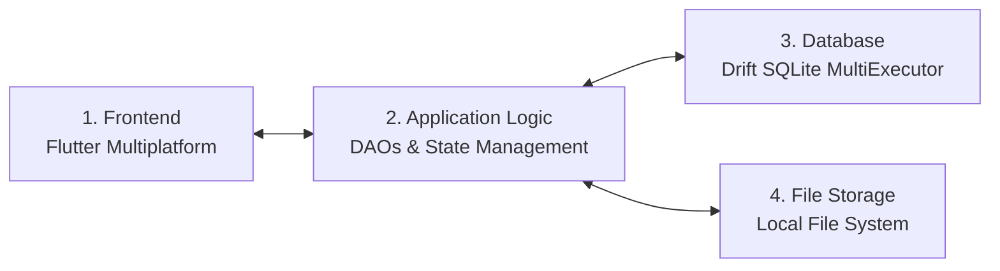
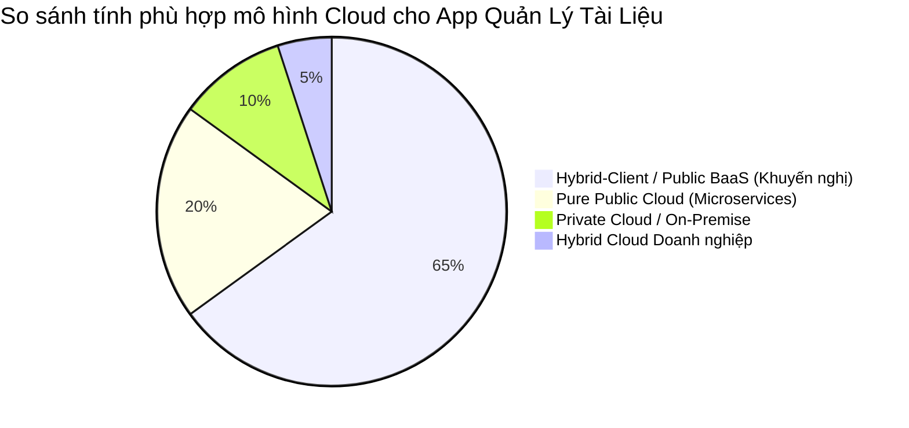
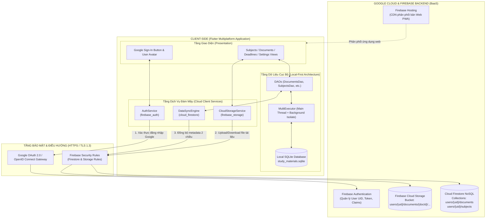
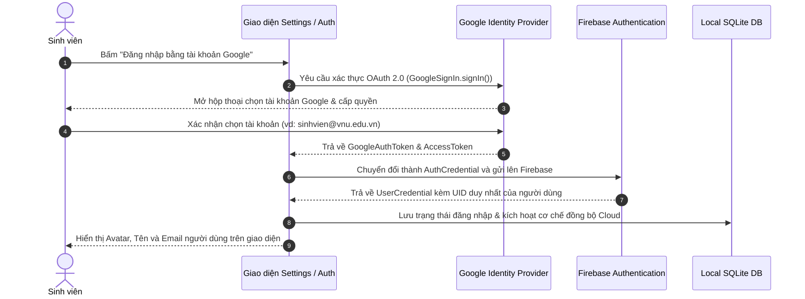
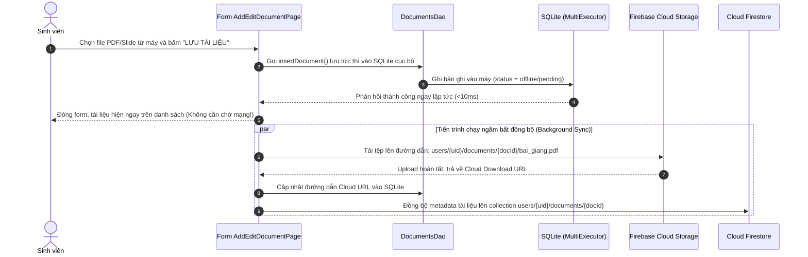
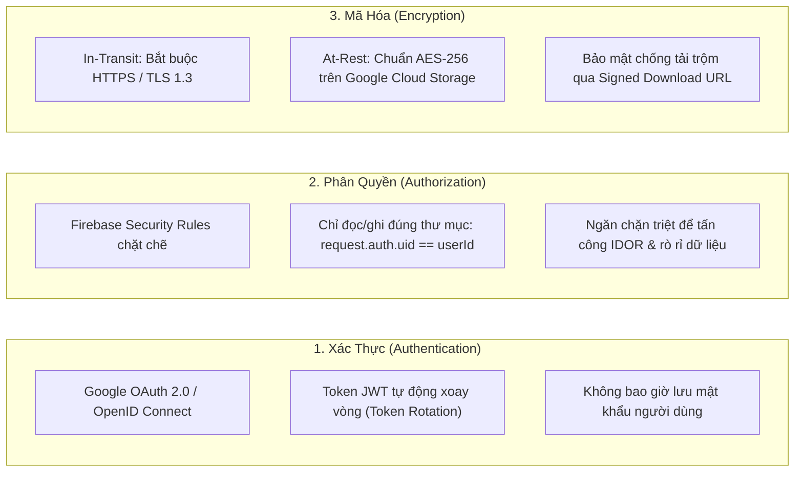
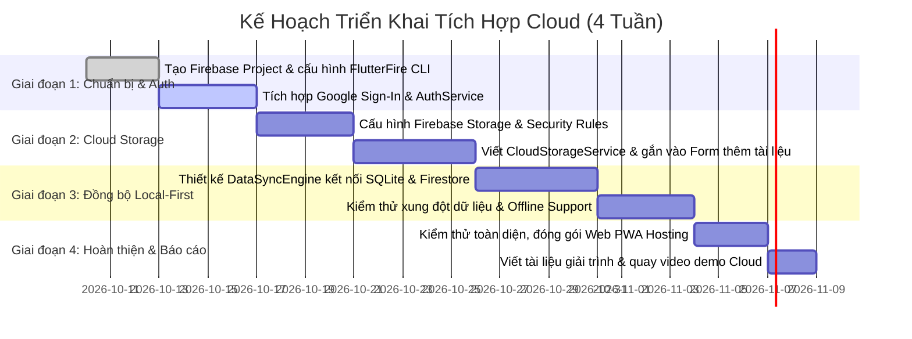

# KẾ HOẠCH CHI TIẾT: PHÂN TÍCH VÀ LẬP PHƯƠNG ÁN TÍCH HỢP CLOUD
## HỆ THỐNG QUẢN LÝ TÀI LIỆU HỌC TẬP (fromCashew2crudTaiLieuHocTap)
> **Phiên bản:** 1.0  
> **Kiến trúc mục tiêu:** Hybrid-Client / Cloud-Native BaaS (Local-First kết hợp Firebase & Google Cloud Storage)  
> **Tài liệu tham chiếu chuẩn:** [Firebase Flutter Setup Guide](https://firebase.google.com/docs/flutter/setup?hl=vi)

---

## MỤC LỤC TÀI LIỆU
1. [Phân Tích Các Thành Phần Cốt Lõi Của Ứng Dụng](#1-liệt-kê-và-phân-tích-các-thành-phần-cốt-lõi-của-ứng-dụng)
2. [Xác Định Các Điểm Nghẽn & Hạn Chế Khi Vận Hành Trên Hạ Tầng Truyền Thống](#2-xác-định-các-điểm-nghẽn-và-hạn-chế-trên-hạ-tầng-truyền-thống)
3. [Lựa Chọn Mô Hình Triển Khai Cloud & Dịch Vụ Cụ Thể](#3-lựa-chọn-mô-hình-triển-khai-cloud-và-dịch-vụ-cụ-thể)
4. [Thiết Kế Sơ Đồ Kiến Trúc Tích Hợp Cloud & Luồng Dữ Liệu](#4-thiết-kế-sơ-đồ-kiến-trúc-tích-hợp-cloud-và-luồng-dữ-liệu)
5. [Đánh Giá Tác Động Về Bảo Mật, Chi Phí Và Hiệu Suất](#5-đánh-giá-tác-động-về-bảo-mật-chi-phí-và-hiệu-suất)
6. [Kế Hoạch Triển Khai Thực Hành Với Firebase (Google Sign-In & Cloud Storage)](#6-kế-hoạch-triển-khai-thực-hành-với-firebase)
7. [Lộ Trình Thực Hiện Từng Giai Đoạn (Roadmap)](#7-lộ-trình-thực-hiện-từng-giai-đoạn-roadmap)

---

## 1. LIỆT KÊ VÀ PHÂN TÍCH CÁC THÀNH PHẦN CỐT LÕI CỦA ỨNG DỤNG

Hệ thống quản lý tài liệu học tập được xây dựng trên nền tảng kiến trúc của **Cashew**, gồm 4 thành phần trụ cột:



### 1.1. Tầng Giao diện & Trình diễn (Frontend Layer)
* **Công nghệ:** Framework Flutter (hỗ trợ đồng thời Web, Windows Desktop, Android và iOS).
* **Mô hình tổ chức:** **Feature-First Architecture** chia tách theo từng miền nghiệp vụ cụ thể:
  * `features/subjects/`: Màn hình danh sách môn học, biểu đồ tiến độ học tập, biểu mẫu thêm/sửa môn học kèm bảng chọn màu nhận diện.
  * `features/documents/`: Kho tài liệu tập trung hỗ trợ tìm kiếm full-text, bộ lọc chip đa tiêu chí, xem chi tiết và cập nhật trạng thái học tập nhanh.
  * `features/deadlines/`: Màn hình quản lý hạn nộp bài tập gom nhóm thông minh (*Quá hạn, Hôm nay, Tuần này, Đã xong*).
  * `features/settings/`: Cài đặt hệ thống, chuyển đổi giao diện sáng/tối, thống kê tổng quan và sao lưu.
* **Quản lý trạng thái & DI:** Kết hợp giữa `Provider` (tiêm phụ thuộc Database vào Widget Tree) và các `StreamBuilder` phản ứng theo luồng dữ liệu từ CSDL.

### 1.2. Tầng Nghiệp vụ ứng dụng (Backend / Business Logic Layer)
* **Mô hình hiện tại:** Xử lý nghiệp vụ phân tán ngay tại Client (Embedded Logic) thông qua các lớp DAO chuyên trách:
  * `DocumentsDao`: Xử lý logic lọc ghép bảng (`leftOuterJoin`), tìm kiếm chuỗi ký tự, chuyển đổi trạng thái (*Cần đọc $\rightarrow$ Đang làm $\rightarrow$ Hoàn thành*), ghim tài liệu (`isPinned`).
  * `SubjectsDao`: Tính toán thống kê tỷ lệ % hoàn thành tài liệu của từng môn học.
  * `DocTypesDao` & `StudyGoalsDao`: Quản lý danh mục loại tài liệu và mục tiêu hạn mức học tập.
* **Cơ chế ghi vết (Audit Logging):** Áp dụng mẫu thiết kế **Tombstone** kế thừa từ Cashew: khi một bản ghi bị xóa, một bản ghi tương ứng được chèn tự động vào bảng `DeleteLogs` để lưu lại vết phục vụ sao lưu/khôi phục.

### 1.3. Tầng Cơ sở dữ liệu (Database Layer)
* **Công nghệ:** CSDL quan hệ **SQLite**, sử dụng ORM **Drift** (trước đây là Moor).
* **Kiến trúc luồng dữ liệu:** **`MultiExecutor`**:
  * Luồng chính (Main Thread): Thực hiện các truy vấn đọc nhanh và duy trì kết nối Stream `.watch()` để tự động cập nhật UI.
  * Luồng nền (Background Isolate): Đảm nhiệm toàn bộ các thao tác ghi đĩa nặng (`INSERT`, `UPDATE`, `DELETE`) nhằm triệt tiêu hiện tượng nghẽn UI, đảm bảo khung hình luôn đạt 60 – 120 FPS.

### 1.4. Tầng Lưu trữ tệp tin (File Storage Layer)
* **Hiện trạng:**
  * Lưu trữ đường dẫn tệp tin cục bộ (Local File Path) do người dùng chọn thông qua thư viện `file_picker`.
  * Lưu trữ liên kết URL trực tuyến (Google Drive, Youtube, OneDrive) và mở qua `url_launcher`.
  * **Hạn chế:** Tệp tin thực tế vẫn nằm phân tán trên ổ cứng cục bộ của thiết bị người dùng.

---

## 2. XÁC ĐỊNH CÁC ĐIỂM NGHẼN VÀ HẠN CHẾ TRÊN HẠ TẦNG TRUYỀN THỐNG

Khi ứng dụng vận hành thuần túy trên hạ tầng cục bộ (Local/On-Premise), hệ thống gặp phải **5 điểm nghẽn nghiêm trọng**:

| STT | Điểm nghẽn / Hạn chế | Nguyên nhân kỹ thuật | Hậu quả thực tế đối với sinh viên |
| :---: | :--- | :--- | :--- |
| **1** | **Không thể đồng bộ đa thiết bị (Siloed Data)** | SQLite lưu trữ tệp `.sqlite` độc lập trên từng thiết bị (Sandbox bộ nhớ máy tính/điện thoại). | Sinh viên thêm bài tập trên Laptop tại lớp thì về nhà mở điện thoại không hề có dữ liệu đó, phải nhập lại thủ công. |
| **2** | **Nguy cơ mất mát dữ liệu vĩnh viễn (Single Point of Failure)** | Cơ chế sao lưu hiện tại dựa hoàn toàn vào việc người dùng nhớ để bấm "Xuất file database" ra ngoài máy. | Nếu máy tính bị hỏng ổ cứng, điện thoại bị mất hoặc vô tình xóa cache trình duyệt Chrome, toàn bộ bài tập và tài liệu mất trắng. |
| **3** | **Giới hạn lưu trữ tệp tin vật lý (Storage Constraints)** | Tệp đính kèm (Slide PDF chất lượng cao, tài liệu tham khảo 50–100MB) chiếm dụng bộ nhớ trong của máy tính/điện thoại. | Gây đầy bộ nhớ thiết bị cá nhân; đường dẫn tệp cục bộ (`C:\Users\...`) sẽ hoàn toàn bị gãy (broken path) khi xuất sang máy khác. |
| **4** | **Thiếu cơ chế định danh & Phân quyền (No Identity / Auth)** | Ứng dụng không có tầng tài khoản; bất kỳ ai mở ứng dụng lên đều có thể xem, sửa hoặc xóa sạch dữ liệu học tập. | Không thể áp dụng cho môi trường dùng chung máy tính tại phòng Lab trường học; dữ liệu cá nhân không có bảo mật. |
| **5** | **Không có khả năng cộng tác & Nhắc nhở từ xa** | Không có máy chủ trung gian để tiếp nhận thông báo đẩy (Push Notification) khi app tắt hoặc chia sẻ tài liệu giữa các nhóm học tập. | Bỏ lỡ deadline quan trọng nếu không chủ động mở app; không thể chia sẻ đề thi hay bài tập chung nhóm. |

---

## 3. LỰA CHỌN MÔ HÌNH TRIỂN KHAI CLOUD VÀ DỊCH VỤ CỤ THỂ

### 3.1. Phân tích và lựa chọn mô hình triển khai Cloud



* **Mô hình Private Cloud:** Yêu cầu tự đầu tư và duy trì máy chủ vật lý, cấu hình IP tĩnh và bảo trì định kỳ. $\rightarrow$ *Không phù hợp vì chi phí quá cao, phức tạp và lãng phí cho một ứng dụng học tập.*
* **Mô hình Pure Public Cloud (Client mỏng - Thin Client):** Mọi thao tác đều bắt buộc phải gọi API lên Cloud Server. Nếu mất mạng Internet thì ứng dụng "đứng hình". $\rightarrow$ *Phá vỡ triết lý Local-First mượt mà của Cashew.*
* **$\rightarrow$ LỰA CHỌN TỐI ƯU:** **Mô hình Hybrid-Client / Public Cloud BaaS (Local-First Edge + Cloud Synchronization)**:
  * **Tại Client:** Giữ nguyên 100% CSDL Drift SQLite cục bộ làm bộ đệm tốc độ cao và nguồn chân lý tức thì (Single Source of Truth cho UI).
  * **Tại Cloud (Public Cloud BaaS):** Tích hợp dịch vụ đám mây công cộng (Google Cloud / Firebase) để giải quyết các bài toán Định danh người dùng (Auth), Lưu trữ tệp tin đám mây (Cloud Storage) và Đồng bộ dữ liệu nền (Cloud Sync).

---

### 3.2. Bảng so sánh và lựa chọn dịch vụ lưu trữ đối tượng (Object Storage)

| Tiêu chí | **Google Cloud Storage (Firebase Storage)** | **Amazon Web Services (AWS S3)** | **Microsoft Azure Blob Storage** |
| :--- | :--- | :--- | :--- |
| **Mức độ tương thích với Flutter** | ⭐⭐⭐⭐⭐ Xuất sắc, hỗ trợ chính chủ bởi Google qua thư viện `firebase_storage`. | ⭐⭐⭐ Trung bình, phải dùng AWS Amplify SDK hoặc AWS SDK bên thứ 3. | ⭐⭐ Khá thấp, thiếu SDK chính thức chất lượng cao cho Flutter. |
| **Tích hợp xác thực (Auth)** | Tích hợp sẵn với Google Sign-In và Firebase Auth qua cơ chế Rules 1 dòng: `request.auth.uid == userId`. | Cần cấu hình phức tạp qua AWS Cognito Identity Pools và IAM Roles. | Cần cấu hình Azure Active Directory (Azure AD B2C) và SAS Tokens. |
| **Chính sách miễn phí (Free Tier)** | **5 GB lưu trữ**, 1 GB tải về/ngày, 20.000 lệnh upload/ngày (hoàn toàn miễn phí vĩnh viễn ở Spark Plan). | 5 GB lưu trữ trong 12 tháng đầu tiên, sau đó tính phí định kỳ. | 5 GB lưu trữ trong 12 tháng đầu tiên. |
| **Độ trễ & CDN tại Việt Nam** | Rất thấp nhờ hệ thống PoP Google Edge đặt tại Đông Nam Á (Singapore, Hong Kong). | Thấp (Region Singapore). | Khá (Region Singapore). |
| **Khả năng triển khai thực tế** | **Cực kỳ nhanh chóng**, chỉ cần cấu hình qua CLI trong 10 phút. | Phức tạp, mất nhiều thời gian cấu hình bảo mật. | Phức tạp, hướng đến khách hàng doanh nghiệp lớn. |

> **KẾT LUẬN LỰA CHỌN:**
> 1. **Dịch vụ Lưu trữ Tệp tin (File Storage):** **Firebase Storage** (nền tảng hạ tầng Google Cloud Storage).
> 2. **Dịch vụ Định danh & Đăng nhập (Authentication):** **Firebase Authentication** kết hợp **Google Sign-In**.
> 3. **Dịch vụ Đồng bộ Metadata:** **Cloud Firestore** (NoSQL Realtime Database).
> 4. **Dịch vụ Hosting Web:** **Firebase Hosting** (máy chủ CDN toàn cầu phục vụ bản build Web).

---

## 4. THIẾT KẾ SƠ ĐỒ KIẾN TRÚC TÍCH HỢP CLOUD VÀ LUỒNG DỮ LIỆU

### 4.1. Sơ đồ kiến trúc tổng thể hệ thống (Cloud Architecture Diagram)



---

### 4.2. Mô tả các luồng dữ liệu cốt lõi (Data Flows)

#### Luồng 1: Xác thực & Đăng nhập người dùng bằng Google (Google Sign-In Flow)


#### Luồng 2: Tải lên tệp tài liệu và lưu trữ lên Cloud Storage (Document Upload Flow)


#### Luồng 3: Đồng bộ dữ liệu hai chiều (Two-Way Synchronization & Conflict Resolution)
* **Quy tắc giải quyết xung đột (Conflict Resolution Rule):**
  * Sử dụng giải thuật **Last-Write-Wins (LWW)** dựa trên trường `dateTimeModified` đã được thiết kế sẵn trong bảng `Documents` và `Subjects`.
  * Khi thiết bị có mạng, `DataSyncEngine` truy vấn các bản ghi trên Firestore có `dateTimeModified > lastSyncTime` để cập nhật vào SQLite cục bộ.
  * Đối với các bản ghi bị xóa, ứng dụng đọc bảng `DeleteLogs` (Tombstone) để phát lệnh xóa tương ứng lên Firestore.

---

## 5. ĐÁNH GIÁ TÁC ĐỘNG VỀ BẢO MẬT, CHI PHÍ VÀ HIỆU SUẤT

### 5.1. Tác động về Bảo mật (Security Assessment)



* **Quy tắc bảo mật Firebase Storage (`storage.rules`):**
  ```javascript
  rules_version = '2';
  service firebase.storage {
    match /b/{bucket}/o {
      // Mỗi người dùng chỉ có toàn quyền trong thư mục tương ứng với UID của mình
      match /users/{userId}/{allPaths=**} {
        allow read, write: if request.auth != null && request.auth.uid == userId;
      }
    }
  }
  ```

---

### 5.2. Tác động về Chi phí (Cost & Budget Analysis)

Hệ thống được thiết kế tối ưu hóa để tận dụng gói dịch vụ miễn phí vĩnh viễn (**Firebase Spark Plan**) của Google:

| Dịch vụ Cloud | Hạn mức Miễn phí hàng ngày / tháng (Spark Plan) | Nhu cầu thực tế (1.000 sinh viên) | Chi phí ước tính |
| :--- | :--- | :--- | :---: |
| **Firebase Authentication** | Không giới hạn cho Google Sign-In | ~1.000 tài khoản sinh viên | **0 VNĐ / tháng** |
| **Firebase Cloud Storage** | **5 GB lưu trữ**, 1 GB tải về/ngày, 20.000 lần ghi/ngày | Trung bình mỗi sinh viên lưu 5MB slide tài liệu cốt lõi | **0 VNĐ / tháng** |
| **Cloud Firestore** | **1 GiB lưu trữ**, 50.000 lượt đọc/ngày, 20.000 lượt ghi/ngày | Dữ liệu text tài liệu và môn học rất nhẹ (<10KB/user) | **0 VNĐ / tháng** |
| **Firebase Hosting** | **10 GB lưu trữ**, 360 MB truyền tải dữ liệu/ngày | Phân phối Web app PWA cho sinh viên truy cập | **0 VNĐ / tháng** |

> **Đánh giá:** Với mô hình này, hệ thống vận hành với **chi phí 0 đồng** trong suốt quá trình thử nghiệm và bảo vệ đồ án. Khi mở rộng lên hàng chục ngàn người dùng trong trường học, chuyển sang gói **Blaze Plan (Pay-as-you-go)** với chi phí phát sinh cực kỳ thấp (~50.000 – 100.000 VNĐ/tháng).

---

### 5.3. Tác động về Hiệu suất (Performance Assessment)

* **Giữ vững tốc độ 60 – 120 FPS của giao diện:** Nhờ mô hình Local-First, ứng dụng luôn đọc/ghi trực tiếp vào CSDL SQLite và bộ nhớ đệm cục bộ trước. Mọi thao tác tìm kiếm, lọc danh mục, mở danh sách bài tập đều phản hồi trong **dưới 16ms** (không phụ thuộc vào tốc độ mạng 3G/4G/Wi-Fi).
* **Trải nghiệm mạng chập chờn (Offline Resilience):** Khi sinh viên mất mạng hoặc vào thang máy, ứng dụng vẫn hoạt động 100% bình thường. Các thao tác thêm tài liệu mới sẽ được đưa vào hàng đợi (Queue) và tự động đồng bộ lên Cloud Storage ngay khi có kết nối trở lại.
* **Tiết kiệm băng thông di động:** Nhờ chỉ đồng bộ các thay đổi mới (Delta Sync qua `dateTimeModified`), hệ thống không tải lại toàn bộ tệp CSDL giúp tiết kiệm tối đa dữ liệu mạng của điện thoại.

---

## 6. KẾ HOẠCH TRIỂN KHAI THỰC HÀNH VỚI FIREBASE
*(Theo tài liệu chính thức: [https://firebase.google.com/docs/flutter/setup?hl=vi](https://firebase.google.com/docs/flutter/setup?hl=vi))*

### Bước 6.1: Chuẩn bị công cụ CLI trên máy tính
1. Cài đặt **Firebase CLI** toàn cục (thông qua Node.js npm hoặc binary độc lập):
   ```bash
   npm install -g firebase-tools
   ```
2. Đăng nhập vào tài khoản Google:
   ```bash
   firebase login
   ```
3. Kích hoạt công cụ cấu hình tự động **FlutterFire CLI**:
   ```bash
   dart pub global activate flutterfire_cli
   ```

---

### Bước 6.2: Cập nhật thư viện trong `pubspec.yaml`
Dự án đã có sẵn `firebase_core`, `firebase_auth`, `cloud_firestore`. Bổ sung thêm thư viện lưu trữ `firebase_storage`:

```yaml
dependencies:
  flutter:
    sdk: flutter
  # ... các thư viện hiện có ...
  firebase_core: ^3.2.0
  firebase_auth: ^5.1.2
  firebase_storage: ^12.1.0        # Bổ sung lưu trữ file đám mây
  cloud_firestore: ^5.1.0
  google_sign_in: ^6.2.1
```
Chạy lệnh cài đặt:
```bash
flutter pub get
```

---

### Bước 6.3: Cấu hình tự động kết nối Firebase (`flutterfire configure`)
Đứng tại thư mục gốc của dự án `fromCashew2crudTaiLieuHocTap`, gõ lệnh:
```bash
flutterfire configure
```
* **Quá trình diễn ra:**
  1. CLI sẽ hiển thị danh sách các dự án Firebase trên tài khoản Google của bạn (hoặc cho phép tạo mới dự án `study-materials-app`).
  2. Chọn các nền tảng muốn hỗ trợ: **`android`**, **`ios`**, **`web`**, **`windows`**.
  3. FlutterFire CLI sẽ tự động sinh tệp mã nguồn: `lib/firebase_options.dart`.

---

### Bước 6.4: Khởi tạo Firebase trong `lib/main.dart`
Cập nhật hàm `main()` để nạp cấu hình Firebase trước khi chạy app:

```dart
import 'package:flutter/material.dart';
import 'package:firebase_core/firebase_core.dart';
import 'firebase_options.dart';
import 'database/study_database.dart';
import 'database/default_data.dart';
import 'navigation/main_navigation_framework.dart';

void main() async {
  WidgetsFlutterBinding.ensureInitialized();

  // Khởi tạo Firebase đa nền tảng
  await Firebase.initializeApp(
    options: DefaultFirebaseOptions.currentPlatform,
  );

  // Khởi tạo CSDL SQLite với MultiExecutor đa luồng của Cashew
  final database = await constructDb('study_materials');
  await populateDefaultStudyData(database);

  runApp(StudyApp(database: database));
}
```

---

### Bước 6.5: Triển khai Dịch vụ Xác thực Google (`AuthService`)
Tạo tệp `lib/core/services/auth_service.dart`:

```dart
import 'package:firebase_auth/firebase_auth.dart';
import 'package:google_sign_in/google_sign_in.dart';

class AuthService {
  final FirebaseAuth _auth = FirebaseAuth.instance;
  final GoogleSignIn _googleSignIn = GoogleSignIn();

  // Theo dõi trạng thái đăng nhập thời gian thực
  Stream<User?> get authStateChanges => _auth.authStateChanges();
  User? get currentUser => _auth.currentUser;

  // Đăng nhập bằng Google
  Future<UserCredential?> signInWithGoogle() async {
    try {
      final GoogleSignInAccount? googleUser = await _googleSignIn.signIn();
      if (googleUser == null) return null; // Người dùng hủy hộp thoại

      final GoogleSignInAuthentication googleAuth = await googleUser.authentication;
      final AuthCredential credential = GoogleAuthProvider.credential(
        accessToken: googleAuth.accessToken,
        idToken: googleAuth.idToken,
      );

      return await _auth.signInWithCredential(credential);
    } catch (e) {
      print('Lỗi đăng nhập Google: $e');
      rethrow;
    }
  }

  // Đăng xuất
  Future<void> signOut() async {
    await _googleSignIn.signOut();
    await _auth.signOut();
  }
}
```

---

### Bước 6.6: Triển khai Dịch vụ Lưu trữ Tệp Đám mây (`CloudStorageService`)
Tạo tệp `lib/core/services/cloud_storage_service.dart`:

```dart
import 'dart:io';
import 'dart:typed_data';
import 'package:firebase_storage/firebase_storage.dart';
import 'package:firebase_auth/firebase_auth.dart';

class CloudStorageService {
  final FirebaseStorage _storage = FirebaseStorage.instance;
  final FirebaseAuth _auth = FirebaseAuth.instance;

  // Tải tệp lên Cloud Storage (hỗ trợ cả Mobile Native & Web qua Uint8List)
  Future<String?> uploadDocumentFile({
    required String documentId,
    required String fileName,
    File? file,
    Uint8List? bytes,
  }) async {
    final user = _auth.currentUser;
    if (user == null) throw Exception('Vui lòng đăng nhập trước khi tải tệp lên đám mây');

    final storageRef = _storage
        .ref()
        .child('users')
        .child(user.uid)
        .child('documents')
        .child(documentId)
        .child(fileName);

    UploadTask uploadTask;
    if (bytes != null) {
      uploadTask = storageRef.putData(bytes);
    } else if (file != null) {
      uploadTask = storageRef.putFile(file);
    } else {
      return null;
    }

    final TaskSnapshot snapshot = await uploadTask;
    final String downloadUrl = await snapshot.ref.getDownloadURL();
    return downloadUrl;
  }

  // Xóa tệp khỏi Cloud Storage khi xóa tài liệu
  Future<void> deleteDocumentFile(String fileUrl) async {
    try {
      final ref = _storage.refFromURL(fileUrl);
      await ref.delete();
    } catch (e) {
      print('Tệp không tồn tại trên Cloud hoặc đã bị xóa trước đó: $e');
    }
  }
}
```

---

## 7. LỘ TRÌNH THỰC HIỆN TỪNG GIAI ĐOẠN (ROADMAP)



| Giai đoạn | Mục tiêu then chốt | Sản phẩm bàn giao (Deliverables) |
| :--- | :--- | :--- |
| **Giai đoạn 1: Định danh (Tuần 1)** | Thiết lập tài khoản, liên kết Google OAuth 2.0 | Tệp `firebase_options.dart`, widget hiển thị thông tin tài khoản tại `SettingsPage`. |
| **Giai đoạn 2: Lưu trữ File (Tuần 2)** | Đẩy tệp PDF/Slide lên Cloud Storage | Upload tệp nhận Download URL, mở tệp trực tiếp từ đám mây, xóa tệp theo cascading. |
| **Giai đoạn 3: Đồng bộ Local-First (Tuần 3)** | Đồng bộ hai chiều SQLite $\leftrightarrow$ Firestore | Thêm/sửa bài tập trên một máy, máy thứ hai tự động cập nhật ngay khi kết nối Internet. |
| **Giai đoạn 4: Nghiệm thu (Tuần 4)** | Đóng gói Web Hosting, kiểm thử bảo mật | Website chạy trên `https://[project-id].web.app`, video demo và tài liệu hoàn chỉnh. |
