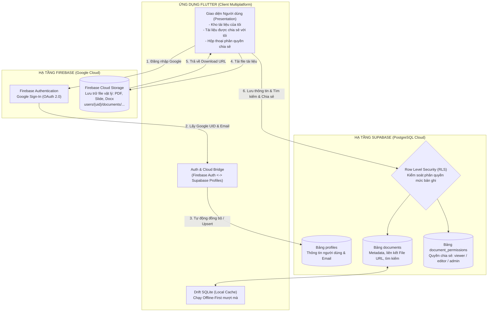

# KẾ HOẠCH CHI TIẾT: TÍCH HỢP SUPABASE VÀO HỆ THỐNG QUẢN LÝ TÀI LIỆU
## KẾT HỢP HYBRID FIREBASE (AUTH & STORAGE) + SUPABASE (POSTGRESQL & RLS)
> **Mục tiêu:** Nâng cấp hệ thống Quản lý Tài liệu Học tập từ mô hình Local-First lên mô hình **Cloud-Native Cộng tác đa người dùng**.  
> **Kiến trúc cốt lõi:**  
> * **Firebase:** Đảm nhiệm Định danh Google (Google Authentication) & Lưu trữ file đám mây (Firebase Storage).  
> * **Supabase (PostgreSQL):** Đảm nhiệm Cơ sở dữ liệu quan hệ đám mây, Tìm kiếm Full-text, Chia sẻ tài liệu theo quyền (Permissions) và Kiểm soát bảo mật mức hàng (**Row Level Security - RLS**).

---

## MỤC LỤC KẾ HOẠCH
1. [Kiến Trúc Tổng Thể: Mô Hình Hybrid Firebase + Supabase](#1-kiến-trúc-tổng-thể-mô-hình-hybrid-firebase--supabase)
2. [Checklist 1: Thiết Lập Firebase & Đăng Nhập Google](#2-checklist-1-thiết-lập-firebase--đăng-nhập-google)
3. [Checklist 2: Cấu Trúc Lưu Trữ File Firebase Storage & Liên Kết Supabase](#3-checklist-2-cấu-trúc-lưu-trữ-file-firebase-storage--liên-kết-supabase)
4. [Checklist 3: Thiết Kế Cơ Sở Dữ Liệu Supabase (Schema 3 Bảng Cốt Lõi)](#4-checklist-3-thiết-kế-cơ-sở-dữ-liệu-supabase)
5. [Checklist 4: Tìm Kiếm, Cập Nhật & Tính Năng Chia Sẻ Tài Liệu](#5-checklist-4-tìm-kiếm-cập-nhật--tính-năng-chia-sẻ-tài-liệu)
6. [Checklist 5: Thiết Lập Chính Sách Bảo Mật Row Level Security (RLS)](#6-checklist-5-thiết-lập-chính-sách-bảo-mật-row-level-security-rls)
7. [Hướng Dẫn Từng Thao Tác Cụ Thể Trên Cloud Console Dành Cho Bạn](#7-hướng-dẫn-thao-tác-trên-cloud-console-dành-cho-bạn)
8. [Tích Hợp Vào Mã Nguồn Flutter (Client Implementation)](#8-tích-hợp-vào-mã-nguồn-flutter-client-implementation)

---

## 1. KIẾN TRÚC TỔNG THỂ: MÔ HÌNH HYBRID FIREBASE + SUPABASE



### Tại sao lại kết hợp Firebase và Supabase?
1. **Google Authentication tốt nhất từ Firebase:** Đăng nhập Google 1 chạm siêu mượt, hỗ trợ native trên cả Web, Android và iOS mà không gặp lỗi cấu hình redirect phức tạp.
2. **Cơ sở dữ liệu Quan hệ mạnh mẽ nhất từ Supabase (PostgreSQL):** Khắc phục nhược điểm lớn của NoSQL (Firestore) khi xử lý bài toán **Phân quyền chia sẻ tài liệu nhiều-nhiều (Many-to-Many)** và **Row Level Security (RLS)** phức tạp.
3. **Phân tách trách nhiệm sạch sẽ (Separation of Concerns):**
   * Tệp tin nặng (Binary File) $\rightarrow$ Đẩy lên Cloud Storage.
   * Dữ liệu cấu trúc, quan hệ, phân quyền, tìm kiếm full-text $\rightarrow$ Quản lý tập trung tại PostgreSQL trên Supabase.

---

## 2. CHECKLIST 1: THIẾT LẬP FIREBASE & ĐĂNG NHẬP GOOGLE

### 2.1. Trạng thái hiện tại của dự án
* **Dự án Firebase đã tạo:** `study-materials-app-8fcf8` (Project Number: `1047174117640`).
* **Google Authentication:** Đã kích hoạt (`Activated`) thành công trên Firebase Console.
* **Mã nguồn đã tích hợp:** `AuthService` tại [`lib/core/services/auth_service.dart`](file:///c:/Users/Nguyen%20Tung%20Duong/Desktop/MobileApp/fromCashew2crudTaiLieuHocTap/lib/core/services/auth_service.dart) cung cấp:
  * `signInWithGoogle()`: Hỗ trợ cả Web Popup và Android/iOS Google Sign-In.
  * `signOut()`: Đăng xuất an toàn.
  * Stream `authStateChanges`: Tự động bắn tín hiệu đăng nhập/đăng xuất cho UI.

### 2.2. Cơ chế cầu nối định danh sang Supabase (Identity Bridge)
Khi sinh viên đăng nhập thành công qua Google trên Firebase, Client sẽ nhận được thông tin:
```json
{
  "uid": "wK8d9X... (Firebase UID duy nhất)",
  "email": "tugduongnguyen@gmail.com",
  "displayName": "Tùng Dương",
  "photoURL": "https://lh3.googleusercontent.com/..."
}
```
Client lập tức gọi hàm đồng bộ sang Supabase để tạo hoặc cập nhật bản ghi tại bảng `profiles`:
```sql
INSERT INTO public.profiles (id, email, display_name, avatar_url, last_sign_in_at)
VALUES ('wK8d9X...', 'tugduongnguyen@gmail.com', 'Tùng Dương', 'https://...', now())
ON CONFLICT (id) DO UPDATE 
SET display_name = EXCLUDED.display_name,
    avatar_url = EXCLUDED.avatar_url,
    last_sign_in_at = now();
```
Nhờ đó, người dùng trong hệ thống Supabase có ID trùng khớp hoàn toàn với Firebase UID!

---

## 3. CHECKLIST 2: CẤU TRÚC LƯU TRỮ FILE FIREBASE STORAGE & LIÊN KẾT SUPABASE

### 3.1. Cấu trúc phân cấp đường dẫn lưu trữ (Bucket Taxonomy)
Mỗi tệp tài liệu được lưu trữ trên Firebase Storage theo quy tắc phân cấp chặt chẽ:

$$\text{Path: } \mathbf{users/\{owner\_uid\}/documents/\{document\_id\}/\{timestamp\}\_\{sanitized\_file\_name\}}$$

* **Ví dụ thực tế:**
  `users/wK8d9X.../documents/doc-1728.../20261013_DeCuongOnTap_INT3120.pdf`
* **Lợi ích kiến trúc:**
  1. Tránh xung đột tên file (hai người cùng tải lên `baitap.pdf` sẽ không bao giờ đè lên nhau).
  2. Dễ dàng xóa theo lô: Khi người dùng xóa tài liệu, chỉ cần xóa thư mục con `documents/{document_id}/`.
  3. Áp dụng quy tắc bảo mật Storage Rules dễ dàng: Chỉ owner mới có quyền ghi vào `users/{userId}/`.

### 3.2. Liên kết giữa Firebase Storage và Bảng `documents` trên Supabase
Bảng `documents` trên Supabase không lưu file nhị phân (tránh phình to dung lượng database), mà chỉ lưu trữ siêu dữ liệu (metadata) trỏ tới Cloud Storage:

| Trường trong Supabase (`documents`) | Kiểu dữ liệu | Ý nghĩa liên kết | Ví dụ dữ liệu |
| :--- | :--- | :--- | :--- |
| `file_url` | `TEXT` | Đường dẫn tải file trực tiếp (Download URL) | `https://firebasestorage.googleapis.com/.../DeCuong.pdf?alt=media&token=...` |
| `file_path` | `TEXT` | Đường dẫn gốc trong Storage Bucket | `users/wK8d9X/documents/doc-1/DeCuong.pdf` |
| `file_name` | `VARCHAR(255)` | Tên file hiển thị thân thiện | `Đề cương ôn tập INT3120.pdf` |
| `file_size` | `BIGINT` | Kích thước file theo bytes | `2457600` (khoảng 2.34 MB) |
| `storage_provider`| `VARCHAR(50)` | Nhà cung cấp lưu trữ | `'firebase_storage'` |

---

## 4. CHECKLIST 3: THIẾT KẾ CƠ SỞ DỮ LIỆU SUPABASE

Mở **SQL Editor** trên Supabase Dashboard và thực thi đoạn mã khởi tạo Schema hoàn chỉnh sau:

```sql
-- ==============================================================
-- 1. BẢNG HỒ SƠ NGƯỜI DÙNG (PROFILES)
-- ==============================================================
CREATE TABLE IF NOT EXISTS public.profiles (
    id TEXT PRIMARY KEY, -- Khớp với Firebase Auth UID
    email VARCHAR(255) UNIQUE NOT NULL,
    display_name VARCHAR(255),
    avatar_url TEXT,
    created_at TIMESTAMPTZ DEFAULT TIMEZONE('utc', now()) NOT NULL,
    last_sign_in_at TIMESTAMPTZ DEFAULT TIMEZONE('utc', now())
);

-- Chỉ mục tìm kiếm người dùng theo email để chia sẻ tài liệu
CREATE INDEX IF NOT EXISTS idx_profiles_email ON public.profiles(email);

-- ==============================================================
-- 2. BẢNG TÀI LIỆU HỌC TẬP (DOCUMENTS)
-- ==============================================================
CREATE TABLE IF NOT EXISTS public.documents (
    id TEXT PRIMARY KEY, -- vd: 'doc-17288...'
    owner_id TEXT NOT NULL REFERENCES public.profiles(id) ON DELETE CASCADE,
    title VARCHAR(255) NOT NULL,
    note TEXT,
    subject_code VARCHAR(50),  -- vd: 'INT3120'
    subject_name VARCHAR(255), -- vd: 'Lập trình di động Flutter'
    doc_type VARCHAR(50) DEFAULT 'Bài tập', -- 'Slide', 'Bài tập', 'Đề thi', 'Giáo trình'
    status INT DEFAULT 0, -- 0: Cần đọc, 1: Đang làm, 2: Hoàn thành
    due_date TIMESTAMPTZ, -- Hạn nộp bài tập / Lịch thi
    is_pinned BOOLEAN DEFAULT false,
    file_url TEXT,
    file_path TEXT,
    file_name VARCHAR(255),
    file_size BIGINT DEFAULT 0,
    storage_provider VARCHAR(50) DEFAULT 'firebase_storage',
    is_public BOOLEAN DEFAULT false, -- Cho phép chia sẻ qua link công khai
    created_at TIMESTAMPTZ DEFAULT TIMEZONE('utc', now()) NOT NULL,
    updated_at TIMESTAMPTZ DEFAULT TIMEZONE('utc', now()) NOT NULL
);

-- Chỉ mục tối ưu hóa truy vấn
CREATE INDEX IF NOT EXISTS idx_documents_owner_id ON public.documents(owner_id);
CREATE INDEX IF NOT EXISTS idx_documents_subject_code ON public.documents(subject_code);
CREATE INDEX IF NOT EXISTS idx_documents_status ON public.documents(status);
CREATE INDEX IF NOT EXISTS idx_documents_due_date ON public.documents(due_date);

-- Chỉ mục Full-Text Search (Tìm kiếm nhanh tiêu đề & ghi chú)
CREATE INDEX IF NOT EXISTS idx_documents_fts ON public.documents 
USING GIN (to_tsvector('simple', title || ' ' || coalesce(note, '')));

-- ==============================================================
-- 3. BẢNG PHÂN QUYỀN CHIA SẺ (DOCUMENT_PERMISSIONS)
-- ==============================================================
CREATE TABLE IF NOT EXISTS public.document_permissions (
    id BIGSERIAL PRIMARY KEY,
    document_id TEXT NOT NULL REFERENCES public.documents(id) ON DELETE CASCADE,
    shared_with_email VARCHAR(255) NOT NULL,
    shared_with_user_id TEXT REFERENCES public.profiles(id) ON DELETE CASCADE,
    permission_level VARCHAR(20) NOT NULL CHECK (permission_level IN ('viewer', 'editor', 'admin')),
    granted_by TEXT NOT NULL REFERENCES public.profiles(id),
    created_at TIMESTAMPTZ DEFAULT TIMEZONE('utc', now()) NOT NULL,
    CONSTRAINT unique_doc_user_share UNIQUE (document_id, shared_with_email)
);

CREATE INDEX IF NOT EXISTS idx_perms_doc_id ON public.document_permissions(document_id);
CREATE INDEX IF NOT EXISTS idx_perms_shared_email ON public.document_permissions(shared_with_email);
CREATE INDEX IF NOT EXISTS idx_perms_shared_user ON public.document_permissions(shared_with_user_id);

-- ==============================================================
-- TRIGGER TỰ ĐỘNG CẬP NHẬT TRƯỜNG updated_at
-- ==============================================================
CREATE OR REPLACE FUNCTION public.handle_updated_at()
RETURNS TRIGGER AS $$
BEGIN
    NEW.updated_at = TIMEZONE('utc', now());
    RETURN NEW;
END;
$$ LANGUAGE plpgsql;

DROP TRIGGER IF EXISTS trigger_documents_updated_at ON public.documents;
CREATE TRIGGER trigger_documents_updated_at
    BEFORE UPDATE ON public.documents
    FOR EACH ROW
    EXECUTE FUNCTION public.handle_updated_at();
```

---

## 5. CHECKLIST 4: TÌM KIẾM, CẬP NHẬT & TÍNH NĂNG CHIA SẺ TÀI LIỆU

### 5.1. Triển khai Chức năng Tìm kiếm Full-Text trên Supabase
Người dùng có thể gõ từ khóa bất kỳ, Supabase sẽ tìm kiếm cả trong `title` và `note` mà không cần duyệt quét toàn bảng:
```dart
// Gọi từ Flutter Supabase Client:
Future<List<Map<String, dynamic>>> searchDocuments({
  required String currentUserId,
  required String query,
  String? subjectCode,
}) async {
  var req = supabase
      .from('documents')
      .select('*, profiles(display_name, email)');

  if (query.isNotEmpty) {
    req = req.or('title.ilike.%$query%,note.ilike.%$query%');
  }
  if (subjectCode != null) {
    req = req.eq('subject_code', subjectCode);
  }

  return await req.order('is_pinned', ascending: false).order('created_at', ascending: false);
}
```

### 5.2. Chức năng Phân Quyền & Chia Sẻ Tài Liệu (Sharing Workflow)
Khi sinh viên A muốn chia sẻ bài giảng cho sinh viên B:
1. Sinh viên A bấm icon **"Chia sẻ"** trên màn hình chi tiết tài liệu.
2. Form hiện lên cho phép:
   * Nhập Email người nhận: `sinhvienB@gmail.com`.
   * Chọn cấp độ quyền:
     * **`viewer` (Người xem):** Chỉ được xem chi tiết, đọc ghi chú và tải file về máy.
     * **`editor` (Người chỉnh sửa):** Được phép sửa tiêu đề, ghi chú, cập nhật trạng thái học tập.
     * **`admin` (Quản trị):** Có toàn quyền sửa và phân quyền tiếp cho người khác.
3. Khi lưu, ứng dụng tự động kiểm tra xem `sinhvienB@gmail.com` đã có tài khoản trong bảng `profiles` chưa:
   * Nếu đã có: Lưu cả `shared_with_user_id` và `shared_with_email`.
   * Nếu chưa có: Lưu `shared_with_email`, khi nào sinh viên B đăng nhập lần đầu hệ thống sẽ tự động liên kết quyền!

---

## 6. CHECKLIST 5: THIẾT LẬP CHÍNH SÁCH BẢO MẬT ROW LEVEL SECURITY (RLS)

Chính sách **Row Level Security (RLS)** trên Supabase đảm bảo không một ai có thể truy vấn hoặc can thiệp trái phép vào tài liệu của người khác, ngay cả khi họ biết ID tài liệu hay gọi API trực tiếp.

Thực thi đoạn mã RLS sau trong **SQL Editor**:

```sql
-- 1. Bật RLS trên toàn bộ các bảng
ALTER TABLE public.profiles ENABLE ROW LEVEL SECURITY;
ALTER TABLE public.documents ENABLE ROW LEVEL SECURITY;
ALTER TABLE public.document_permissions ENABLE ROW LEVEL SECURITY;

-- ==============================================================
-- CHÍNH SÁCH BẢNG PROFILES
-- ==============================================================
-- Ai cũng có thể đọc profile của người khác (để hiển thị tên/avatar người chia sẻ)
CREATE POLICY "Public profiles are viewable by everyone" 
ON public.profiles FOR SELECT 
USING (true);

-- Người dùng chỉ được sửa thông tin profile của chính mình
CREATE POLICY "Users can update their own profile" 
ON public.profiles FOR UPDATE 
USING (request.jwt.claim('sub') = id OR current_setting('request.headers', true)::json->>'x-user-id' = id);

-- Cho phép chèn hồ sơ mới
CREATE POLICY "Users can insert their own profile" 
ON public.profiles FOR INSERT 
WITH CHECK (true);

-- ==============================================================
-- CHÍNH SÁCH BẢNG DOCUMENTS (BẢO MẬT CỐT LÕI)
-- ==============================================================

-- A. QUYỀN ĐỌC (SELECT):
-- Sinh viên được xem tài liệu nếu:
-- 1. Là chủ sở hữu (owner_id)
-- 2. HOẶC tài liệu được bật công khai (is_public = true)
-- 3. HOẶC được cấp quyền trong bảng document_permissions
CREATE POLICY "Users can view accessible documents" 
ON public.documents FOR SELECT 
USING (
    owner_id = coalesce(current_setting('request.headers', true)::json->>'x-user-id', '')
    OR is_public = true
    OR EXISTS (
        SELECT 1 FROM public.document_permissions dp 
        WHERE dp.document_id = documents.id 
        AND (
            dp.shared_with_user_id = coalesce(current_setting('request.headers', true)::json->>'x-user-id', '')
            OR dp.shared_with_email = coalesce(current_setting('request.headers', true)::json->>'x-user-email', '')
        )
    )
);

-- B. QUYỀN TẠO MỚI (INSERT):
-- Chỉ được tạo tài liệu cho chính mình
CREATE POLICY "Users can insert their own documents" 
ON public.documents FOR INSERT 
WITH CHECK (
    owner_id = coalesce(current_setting('request.headers', true)::json->>'x-user-id', '')
);

-- C. QUYỀN CẬP NHẬT (UPDATE):
-- Chủ sở hữu HOẶC người có quyền 'editor' / 'admin' mới được sửa
CREATE POLICY "Owners and editors can update documents" 
ON public.documents FOR UPDATE 
USING (
    owner_id = coalesce(current_setting('request.headers', true)::json->>'x-user-id', '')
    OR EXISTS (
        SELECT 1 FROM public.document_permissions dp 
        WHERE dp.document_id = documents.id 
        AND dp.permission_level IN ('editor', 'admin')
        AND (
            dp.shared_with_user_id = coalesce(current_setting('request.headers', true)::json->>'x-user-id', '')
            OR dp.shared_with_email = coalesce(current_setting('request.headers', true)::json->>'x-user-email', '')
        )
    )
);

-- D. QUYỀN XÓA (DELETE):
-- DUY NHẤT chủ sở hữu mới có quyền xóa tài liệu
CREATE POLICY "Only owners can delete documents" 
ON public.documents FOR DELETE 
USING (
    owner_id = coalesce(current_setting('request.headers', true)::json->>'x-user-id', '')
);

-- ==============================================================
-- CHÍNH SÁCH BẢNG DOCUMENT_PERMISSIONS
-- ==============================================================
-- Xem quyền: Chủ tài liệu hoặc người được chia sẻ
CREATE POLICY "View permissions" 
ON public.document_permissions FOR SELECT 
USING (
    granted_by = coalesce(current_setting('request.headers', true)::json->>'x-user-id', '')
    OR shared_with_user_id = coalesce(current_setting('request.headers', true)::json->>'x-user-id', '')
    OR shared_with_email = coalesce(current_setting('request.headers', true)::json->>'x-user-email', '')
);

-- Thêm/Xóa quyền chia sẻ: Chỉ chủ sở hữu tài liệu
CREATE POLICY "Manage permissions" 
ON public.document_permissions FOR ALL 
USING (
    EXISTS (
        SELECT 1 FROM public.documents d 
        WHERE d.id = document_permissions.document_id 
        AND d.owner_id = coalesce(current_setting('request.headers', true)::json->>'x-user-id', '')
    )
);
```

---

## 7. HƯỚNG DẪN THAO TÁC TRÊN CLOUD CONSOLE DÀNH CHO BẠN

Dưới đây là các thao tác bạn chỉ cần thực hiện 1 lần trên trình duyệt web:

### Bước 1: Tạo tài khoản & Dự án trên Supabase
1. Mở trình duyệt và truy cập: [https://supabase.com](https://supabase.com)
2. Bấm nút **Sign In** $\rightarrow$ Chọn **Continue with GitHub** (đăng nhập bằng tài khoản GitHub `tugduong57` của bạn).
3. Bấm nút **"New project"** (Tạo dự án mới):
   * **Name (Tên dự án):** `study-materials-supabase` (hoặc tên tùy thích).
   * **Database Password:** Đặt một mật khẩu an toàn (ví dụ: `StudyMaterials@2026!`).
   * **Region (Khu vực):** Chọn **`Singapore (ap-southeast-1)`** *(gần Việt Nam nhất, tốc độ cao)*.
   * **Pricing Plan:** Chọn **Free plan** ($0/tháng).
4. Bấm **Create new project** $\rightarrow$ Đợi khoảng 1 – 2 phút để Supabase cấp phát máy chủ PostgreSQL cho bạn.

---

### Bước 2: Lấy thông tin API Keys
1. Trong màn hình dự án Supabase, nhìn vào cột menu bên trái $\rightarrow$ Bấm vào biểu tượng bánh răng **Project Settings** (ở dưới cùng).
2. Chọn mục **API**:
   * Sao chép dòng **Project URL** (dạng `https://xyzcompany.supabase.co`).
   * Sao chép dòng **anon (public) key** (chuỗi ký tự dài bắt đầu bằng `eyJ...`).
*(Hai khóa này sẽ được điền vào file cấu hình `supabase_config.dart` trong ứng dụng Flutter).*

---

### Bước 3: Chạy mã SQL tạo bảng và bảo mật RLS
1. Ở menu bên trái Supabase Dashboard, bấm vào biểu tượng **SQL Editor** *(hình trang giấy có chữ `>_`)*.
2. Bấm nút **"New query"** (hoặc dấu `+`).
3. Copy toàn bộ đoạn mã SQL ở **Mục 4 và Mục 6** trong tài liệu này $\rightarrow$ Dán vào khung soạn thảo.
4. Bấm nút màu xanh **RUN** (hoặc nhấn tổ hợp phím `Ctrl + Enter`).
5. Kết quả hiện `Success. No rows returned` $\rightarrow$ Toàn bộ 3 bảng và các chính sách bảo mật RLS đã được kích hoạt thành công 100%!

---

### Bước 4: Kiểm tra trực quan trên Table Editor
1. Ở menu bên trái, bấm vào mục **Table Editor** *(hình bảng tính)*.
2. Bạn sẽ thấy ngay 3 bảng:
   * **`profiles`**
   * **`documents`**
   * **`document_permissions`**
   * Bên cạnh mỗi bảng đều có biểu tượng ổ khóa xanh: **`RLS Enabled`**.

---

## 8. TÍCH HỢP VÀO MÃ NGUỒN FLUTTER (CLIENT IMPLEMENTATION)

### 8.1. Cài đặt thư viện `supabase_flutter` vào `pubspec.yaml`
```yaml
dependencies:
  # ... các gói hiện có ...
  firebase_core: ^3.2.0
  firebase_auth: ^5.1.2
  firebase_storage: ^12.1.0
  supabase_flutter: ^2.8.0    # Bổ sung Supabase SDK
```

### 8.2. Tạo tệp cấu hình Supabase: `lib/core/config/supabase_config.dart`
```dart
class SupabaseConfig {
  static const String url = 'YOUR_SUPABASE_PROJECT_URL';
  static const String anonKey = 'YOUR_SUPABASE_ANON_KEY';
}
```

### 8.3. Khởi tạo đồng thời Firebase và Supabase trong `lib/main.dart`
```dart
void main() async {
  WidgetsFlutterBinding.ensureInitialized();

  // 1. Khởi tạo Firebase
  await Firebase.initializeApp(options: DefaultFirebaseOptions.currentPlatform);
  AuthService().initialize();

  // 2. Khởi tạo Supabase
  await Supabase.initialize(
    url: SupabaseConfig.url,
    anonKey: SupabaseConfig.anonKey,
  );

  // 3. Khởi tạo Drift SQLite Local-First
  final database = await constructDb('study_materials');
  await populateDefaultStudyData(database);

  runApp(StudyApp(database: database));
}
```

### 8.4. Dịch vụ Supabase Service chuyên trách: `lib/core/services/supabase_service.dart`
Cung cấp các hàm:
* `syncProfile(User firebaseUser)`: Tự động lưu/cập nhật thông tin sinh viên sang bảng `profiles`.
* `getDocuments(String userId)`: Lấy toàn bộ tài liệu của tôi + tài liệu được chia sẻ cho tôi.
* `saveDocument(Map<String, dynamic> docData)`: Tạo mới hoặc cập nhật tài liệu lên Supabase.
* `shareDocument({required String documentId, required String recipientEmail, required String permission})`: Thêm quyền chia sẻ cho bạn học.
* `deleteDocument(String documentId)`: Xóa tài liệu khỏi Supabase (tự động xóa cascade quyền chia sẻ).
